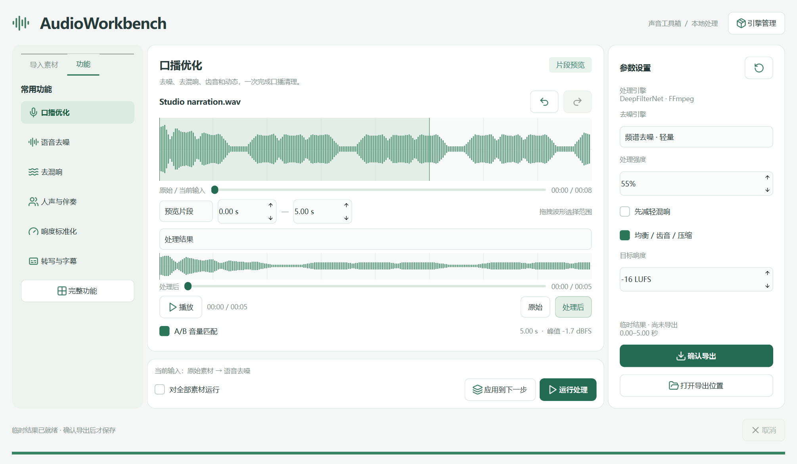
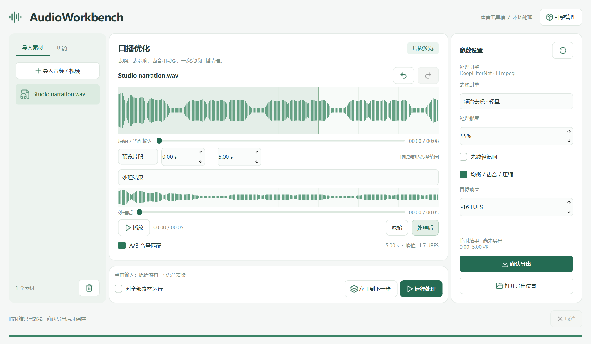

# AudioWorkbench · 音频工具箱

原生 Windows 桌面 GUI，PySide6 实现。37 项文件音频工具，统一青绿线性图标，支持片段预览与完整音频处理。无需浏览器或付费 API。

## 下载与安装 · v1.1.0

下载地址：[GitHub Releases](https://github.com/NaGeShuDai/AudioWorkbench/releases/tag/v1.1.0)。

| 文件 | 使用方式 |
|---|---|
| `AudioWorkbench-1.1.0-Setup-x64.exe` | 安装版，双击按向导安装；无需管理员权限，默认安装到当前用户的 LocalAppData/Programs/AudioWorkbench，提供开始菜单入口、可选桌面快捷方式与卸载入口 |
| `AudioWorkbench-v1.1.0-Windows-x64.zip` | 便携版，完整解压后运行文件夹中的 AudioWorkbench.exe |
| `SHA256SUMS.txt` | 下载文件的 SHA-256 校验值 |

安装版与便携版功能相同，均无需预装 Python。支持 Windows 10/11 x64。安装版升级可安装到原目录；卸载移除程序和快捷方式，保留按需下载的引擎与模型。若不再需要，可在退出并卸载后自行删除安装目录中的 `.engines`、`models` 和 `bin`。用户确认导出的文件不会被卸载程序删除。

### 本次更新

- 移除左侧的临时保存说明及底部默认“就绪”说明文字；处理进度、错误及取消提示继续正常显示。
- 左侧拆分为“导入素材”和“功能”两个选项卡；切换不影响当前素材、参数、处理结果和播放。
- 素材页提供导入、素材列表、排序和移除；功能页提供常用工具和完整功能面板。
- 提供便携版及安装版，保留处理动画、上下双播放进度条和显式确认导出机制。

## Windows 便携版

在 Releases 下载 `AudioWorkbench-v1.1.0-Windows-x64.zip`，完整解压到可写目录，双击 `AudioWorkbench.exe`。无需预装 Python。请保留同目录的 DLL、assets 和其他文件，不要只拷贝 EXE。

基础工具内置；AI 环境、Python 3.11 和模型在「引擎管理」按需下载，下载需要网络，可能占用数 GB。模型不包含在压缩包中。应用未进行商业代码签名。

上方进度条对应原始 / 当前输入，下方对应处理结果，支持拖动与键盘定位，拖动保留播放或暂停状态。预览结果的下方时间从 0 开始，长度为所选片段。处理期间底部旋转指示器持续动画，取消或结束后停止。





## 从源码启动

双击 **`quick start.bat`**。重复启动会激活现有窗口。首次启动自动配置主环境；AI 隔离环境通过「引擎管理」安装。

换到新机器时，启动器需要 uv 和网络，自动创建 Python 3.11 环境。首次运行某个 AI 模型会下载权重。GPU 仅在隔离环境、CUDA 依赖和硬件均可用时启用；CPU 为默认设备。

## 三栏操作

- **左侧**：「导入素材」页导入、选择、排序或移除音频；「功能」页选择常用工具，点击「完整功能」打开 37 项工具面板，可按类别和关键词筛选。
- **中间**：当前素材、输入音轨选择、拖拽波形选区、片段 / 完整范围、原音与处理结果试听。分离工具显示音轨选择；转写显示可编辑表格；频谱与响度显示各自的分析视图。
- **右侧**：仅显示当前工具的模型和参数，底部「确认导出」。

操作顺序：**导入 → 选择工具 → 选择片段或完整范围 → 运行 → 试听 / 编辑 → 确认导出**。

初始预览选区为前 15 秒（不足 15 秒则选全部），可输入起止时间或拖动波形修改。点击波形定位播放。音量匹配仅影响试听，采用 RMS 近似。

## 功能

| 分类 | 工具 |
|---|---|
| 自动流程 | 口播优化、自定义处理链 |
| 清理修复 | 语音去噪、去混响、电流嗡声、低频风噪、咔嗒修复、削波修复、直流偏移 |
| 音源分离 | 人声与伴奏、乐器分轨 |
| 音色动态 | 参数均衡、高低通、齿音控制、动态压缩、峰值限幅、噪声门、响度标准化、增益、立体声宽度 |
| 剪辑时间 | 裁剪、等长分割、拼接、淡入淡出、首尾静音裁剪、缩短停顿、变速不变调、变调不变速、倒放 |
| 格式交付 | 声道处理、格式转换、视频音轨提取 |
| 分析字幕 | 响度与峰值、频谱图、静音检测、语音活动检测、转写与字幕 |

拼接使用左侧素材顺序，支持拖动排序；处理范围必须为完整音频。等长分割和分离会生成多条临时音轨，导出时可以单轨保存或打包 ZIP。批量运行按文件列表执行当前配方，片段范围对每个素材分别适用；短于选区的素材会明确报错。

## 口播与多步编辑

默认口播链：可选去混响 → 去噪 → 可选高通 / EQ / 齿音 / 压缩 → 两遍响度调整。

「自定义处理链」可添加、双击设置、上移、下移、移除步骤，最多 16 步；只允许单轨音频处理工具，不嵌套处理链。

任意单轨或分离音轨可「应用到下一步」，成为当前素材的临时工作版本。支持撤销 / 重做。应用预览片段时会明确询问，因为后续输入将只剩该片段。相同配方可复用本次会话内的处理缓存。

## 仅确认导出才保存

**所有导入解码、预览、完整处理、处理中间文件与缓存，均位于系统临时目录 `AudioWorkbench-sessions-v2/session-*`。程序不再自动生成 `outputs/任务目录`。**

- 原文件只读；禁止将导出路径设置为原文件路径。
- 「运行处理」和「应用到下一步」都不会向用户目录保存音频。
- 「确认导出」选择范围对应的结果、音轨、格式、采样率、位深，再选择保存位置。
- 只有成功导出，最终文件才原子提交到指定位置；取消 / 失败删除未完成文件。
- 关闭素材会删除该素材临时文件，退出会删除整个会话。未导出编辑会提示返回或丢弃。
- 异常退出残留的临时会话，下次启动通过文件锁识别并清理；其他正在运行的会话不会被误删。
- 模型权重、程序设置、依赖与文档可以持久保留，不属于用户音频结果。
- 升级前旧版本已保存的文件不会自动删除。

临时文件仍需占用磁盘，以支持长音频、播放器和 AI 引擎；“仅导出保存”指不留下未经确认的永久用户结果，不代表所有处理都只在内存里执行。

## 导出

音频：WAV（16 / 24 位整数、32 位浮点）、FLAC、MP3、AAC/M4A、Ogg。采样率可选 16 / 22.05 / 44.1 / 48 / 96 kHz；内部编辑统一为 48 kHz 双声道，声道工具可输出单声道。

其他：多音轨 ZIP、SRT / TXT 字幕、JSON 分析结果、PNG 频谱图。只生成用户选定的文件，不自动附带日志或中间 WAV。

视频：输入可选择不同音轨；导出 MKV 时复制第一条视频流并使用所选处理音轨。不会复制额外音轨和字幕。片段、变速、停顿压缩、裁剪等改变时间轴的结果禁止直接替换视频音轨，避免错位；本版不自动剪辑视频画面。

字幕：可编辑时间戳和文字，双击行定位试听；导出时间从当前处理结果的 0 秒开始。字幕识别不是说话人身份识别。

## 开源引擎

具体选型、项目链接、模型与边界见 **[docs/OPEN_SOURCE.md](docs/OPEN_SOURCE.md)**。

- FFmpeg + Rubber Band：基础处理、格式、剪辑、动态、响度、频谱。
- DeepFilterNet3 + noisereduce：AI / 轻量去噪。
- Audio Separator：MDX、专用去混响、HTDemucs 分轨；可选 MelBand / BS RoFormer 模型。
- faster-whisper：离线转写；Silero VAD ONNX：语音活动检测。
- Lucide 0.468.0：矢量图标，许可在 `assets/icons/LICENSE`。

「引擎管理」检查 / 安装依赖。模型在首次调用时下载，安装依赖成功不代表所有模型权重已下载。可选模型名称清楚标注按需下载；高质量候选未被宣称为所有素材上的最佳模型。

转写支持官方 Hugging Face 源、显式可选的 HF-Mirror 第三方镜像，以及本地 CTranslate2 模型目录。程序优先读取已缓存模型，无缓存时使用界面选择的来源。第三方镜像仅下载公开权重，不发送音频，也不隐式携带 Hugging Face 登录令牌。

Resemble Enhance（原生 Windows 兼容性）、实时麦克风 AEC、同一人身份识别、目标说话人提取及复杂视频剪辑不包含在本版；没有把未接入能力伪装成可用按钮。

## 验证与局限

```powershell
.venv/Scripts/python.exe -m unittest discover -s tests -p test_toolbox.py -v
.venv/Scripts/python.exe -u tests/gui_toolbox.py
.venv/Scripts/python.exe -u tests/ai_toolbox.py denoise dereverb vocals stems vad transcribe
```

验证记录见 **[docs/VALIDATION.md](docs/VALIDATION.md)**。测试使用合成波形和 Windows 语音合成，不包含用户真实录音的主观听感评估；不保证任意噪声、混响或削波都可恢复。

AI 分离与长音频可能消耗大量内存。基础去噪分块处理；各 AI 模型的内部切块策略由对应引擎决定。先选短片段试听，再处理整段。

## 代码结构

```text
main.py                         单实例入口
audioworkbench/desktop.py        三栏原生 GUI、播放、任务与导出
audioworkbench/ui_components.py  图标、完整功能面板、参数、模型与导出窗口
audioworkbench/catalog.py        37 项功能及参数注册表
audioworkbench/session.py        临时会话、锁、工作版本与缓存
audioworkbench/toolbox.py        功能调度、DSP、分析、原子导出
audioworkbench/tool_worker.py    分离与语音 AI 隔离进程
audioworkbench/model_worker.py   DeepFilterNet / 兼容适配
audioworkbench/install_engine.py 隔离依赖安装
assets/icons/                   离线 SVG 图标与许可
docs/                           选型、验证与界面截图
tests/                          信号、生命周期、导出及 GUI 检查
```

## 构建与验证

```powershell
uv pip install --python .venv/Scripts/python.exe pyinstaller==6.22.3 pillow
.venv/Scripts/python.exe scripts/create_icon.py
.venv/Scripts/python.exe scripts/build_windows.py
# 安装 Inno Setup 6+，或设置 ISCC 环境变量后：
.venv/Scripts/python.exe scripts/build_installer.py
.venv/Scripts/python.exe tests/test_ui_updates.py
.venv/Scripts/python.exe tests/gui_toolbox.py
.venv/Scripts/python.exe -m unittest tests/test_toolbox.py
```

构建结果为 `dist/AudioWorkbench/AudioWorkbench.exe`。便携版可运行 `AudioWorkbench.exe --self-test <报告绝对路径.json>` 验证本机导入、处理、定位和导出；测试音频自动清理，报告及截图保存在指定位置。

本项目原始代码与应用图标使用 GPL-3.0-or-later。依赖和模型适用各自许可，参见 LICENSE、THIRD_PARTY.md 与 docs/OPEN_SOURCE.md。
